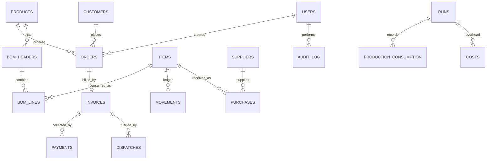

# Design Note — Order-to-Audit System

## 1. Data model

The database separates master data (users, customers, products, items, suppliers, BOM) from transaction data (orders, purchases, runs, invoices, payments, dispatches, costs) and the movement/audit ledgers.

## 2. Inventory and production

Balances are derived by summing `movements.delta` for each `item_id`. A purchase adds a positive movement. A production run adds negative movements for each raw/packaging input and a positive movement for good finished packets. A dispatch adds a negative finished-goods movement. Transaction rows and movements are committed in one database transaction so a failed operation rolls back together.

A BOM line stores the standard material quantity for one batch. The prototype's benchmark BOM batch yields 200 packets. Planned quantities are the full BOM quantities; actual quantities are user-entered. This avoids scaling standard consumption down merely because actual yield is lower. Yield and material variances are calculated with decimal arithmetic and rounded to three decimal places for quantities/percentages.

## 3. GST and receivables

Taxable value = order quantity × product price. GST amount = taxable value × configured product GST rate. For the benchmark, Tamil Nadu customer orders split 5% GST into CGST and SGST (2.5% each); interstate Karnataka orders use IGST. Payments update invoice paid amount and receivables = invoice total − paid amount.

This is a demonstration rule, not a complete GST determination engine. GSTIN, HSN, invoice sequence by financial year and PDF invoice output remain future work.

## 4. Costing method and limitation

The prototype records labour and utilities by production run and reports overhead per good packet = (labour + utilities) / good output. Material purchase prices are recorded, but the current implementation does not apply FIFO or weighted-average valuation to opening stock and consumption. Consequently the reported amount is overhead-only, not full manufacturing cost. A production-ready extension should adopt weighted-average or FIFO, persist cost layers, add material cost to run overhead and expose gross margin by product.

## 5. Traceability

New purchase, production and dispatch stock movements carry a `reference_type` and `reference_id`; audit events carry actor, timestamp, entity, action and details. Legacy opening/imported movement rows can have null structured references and are identifiable by their source text. Backfill these when migrating old data.
